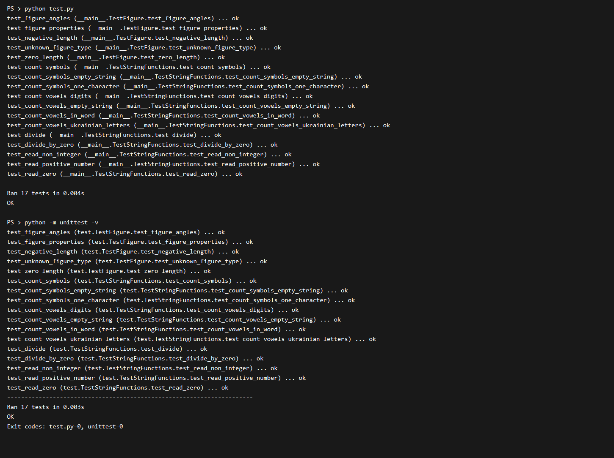
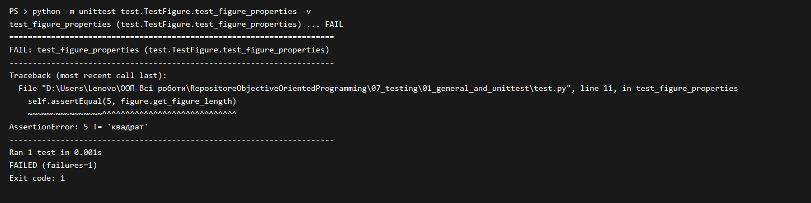

# Звіт до завдання

## Загальне тестування та юніт-тести

### 1. Перевірка введення

Функція приймає додатне ціле число, а текстове, нульове й від'ємне значення повідомляють про помилку. На зображенні є приклади правильного та неправильного введення.

Перевірка правильного та неправильного введення 

### 2. Тестування функцій і фігур

Перевірено підрахунок символів і голосних (звичайний, порожній, числовий та український рядки), ділення на нуль і властивості `Figure`. Тести кутів охоплюють квадрат, прямокутник і рівносторонній трикутник; також перевірено нульову та від'ємну довжину й невідомий тип.



### 3. Помилка та її виправлення

Початково `get_figure_length` повертав назву фігури замість переданої довжини, тому тест очікувано впав. Властивість виправлено на повернення `self.length`; після цього всі 17 тестів пройшли.

**До виправлення:**



**Після виправлення:** успішний результат усіх тестів показано в попередньому розділі.

### 4. Команди запуску та додаткові можливості

Команди потрібно виконувати з каталогу `07_testing/01_general_and_unittest`:

```powershell
python test.py
python -m unittest -v
```

`subTest` запускає перевірку для кожного типу фігури й указує тип у разі помилки. `unittest.mock.patch` підміняє `input()` у тесті, тому можна перевірити результат і виклик функції без ручного введення.

Кожен метод `test_` виконується окремо, тож перевірки не залежать одна від одної. `setUp`/`tearDown` та їхні class-варіанти можна додати для спільного створення й очищення ресурсів; у цьому прикладі спільного стану немає, тому вони не потрібні.
