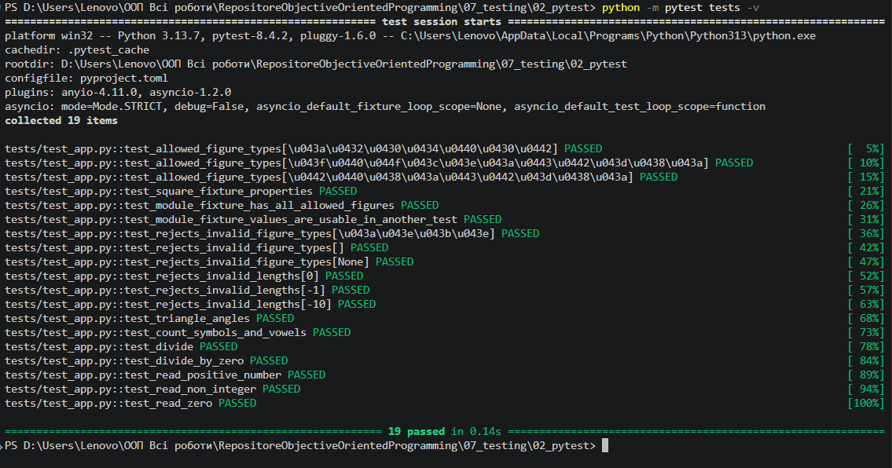
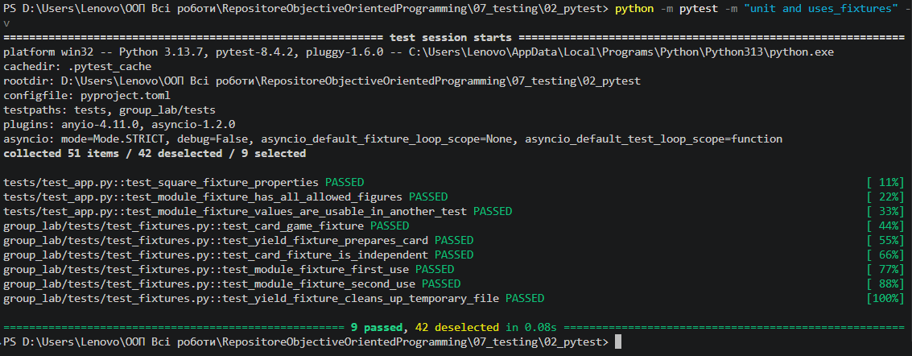
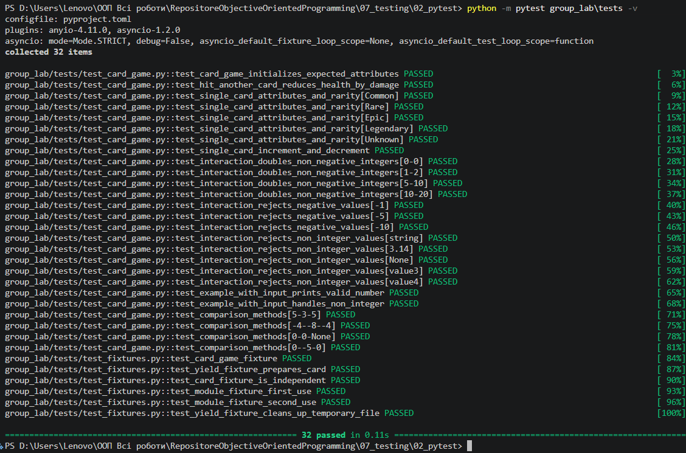
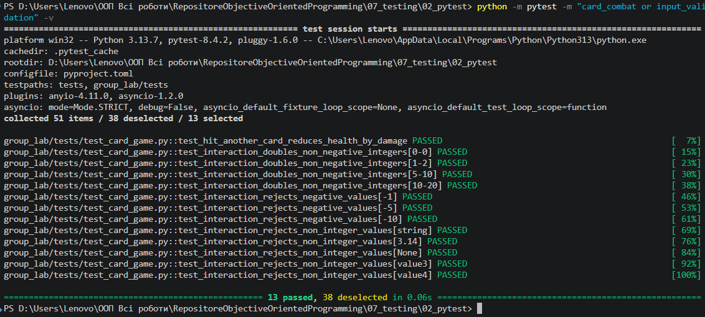
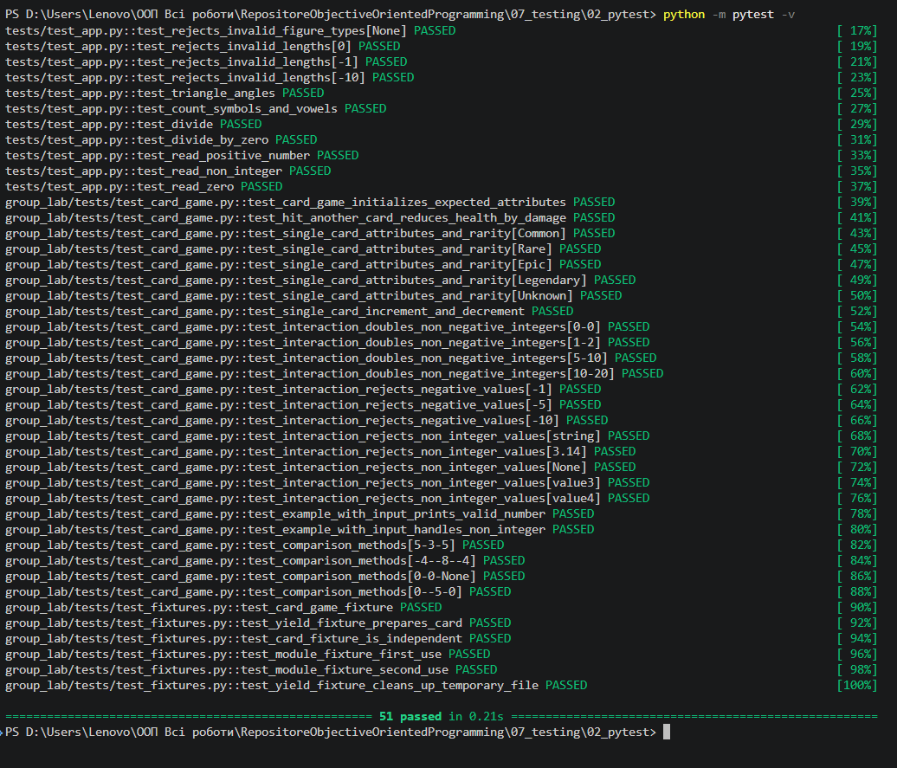

# Звіт до завдання

## Тестування з бібліотекою pytest

### 1. Параметризація тестів і перевірка фігур

Для кожного дозволеного типу фігури створено окремий параметр тесту. Додатково перевірено кути трикутника, підрахунок символів і голосних, ділення та обробку додатного числа. Неправильні типи фігур, нульову й від'ємну довжини, ділення на нуль, текстове та нульове введення перевірено через очікувані винятки.

Тести розташовані у `tests/test_app.py`. Наприклад, параметризований тест одного методу запускається для всіх значень із `Figure.FIGURES`, а не потребує окремого методу для кожного типу.

Запуск цієї частини командою `python -m pytest tests -v`:



### 2. Fixtures і їхня область дії

У `conftest.py` створено fixture `square` з довжиною 10 та fixture `allowed_figures` з областю дії `module`. Їхні значення перевіряються в кількох тестах.

У тестах лабораторної додатково є fixtures для карток, fixture з `yield` для дій до та після тесту і fixture, що створює тимчасовий файл та видаляє його після перевірки. Це демонструє підготовку ресурсів і гарантоване очищення.

На зображенні відібрано тести, які мають одночасно маркери `unit` і `uses_fixtures`. Інші 42 тести не запускалися:



### 3. Перевірка матеріалів лабораторної №2

У `group_lab` реалізовано приклади `CardGame` та `SingleCardGame`. Перевірено створення карт і їхні атрибути, зміну здоров'я після атаки, рідкість та зміну характеристик, валідацію чисел, користувацьке введення й порівняння аргументів.

У тестах застосовано fixtures, параметризацію та маркери `unit`, `card_combat`, `input_validation`, `input_handling`, `comparison`, `uses_fixtures` та інші маркери лабораторної.

Запуск тестів лабораторної командою `python -m pytest group_lab\tests -v`:



Також окремо перевірено відбір тестів бою та валідації командою `python -m pytest -m "card_combat or input_validation" -v`:



### 4. Запуск тестів і результат

Команди потрібно виконувати з каталогу `07_testing/02_pytest`:

```powershell
python -m pip install pytest
python -m pytest -v
```

Для запуску окремих наборів тестів:

```powershell
python -m pytest tests -v
python -m pytest group_lab/tests -v
python -m pytest -m "unit and uses_fixtures" -v
python -m pytest -m "card_combat or input_validation" -v
python -m pytest --collect-only
```

Повний запуск завершився успішно: **51 passed in 0.21s**. Запуск тестів фігур дав **19 passed in 0.14s**, лабораторної — **32 passed in 0.11s**. Вибір тестів маркерами `unit and uses_fixtures` дав **9 passed, 42 deselected in 0.08s**.

Повний запуск команди `python -m pytest -v` показано нижче. У кожному рядку `PASSED` означає, що відповідна перевірка пройшла:



### 5. Питання та відповіді

**Чим функціональні тести pytest відрізняються від тестів `unittest.TestCase`?**

У pytest достатньо функцій із назвою `test_` і звичайного `assert`. `unittest.TestCase` використовує клас, методи перевірки на кшталт `assertEqual` та, за потреби, методи підготовки й очищення `setUp`/`tearDown`. Pytest також уміє запускати тести, написані з `unittest`.

**Для чого потрібні параметризація та fixtures?**

`pytest.mark.parametrize` запускає одну перевірку на кількох наборах даних. Fixture готує дані або ресурс для тесту; fixture з областю `module` повторно використовується в межах модуля, а `yield` дає змогу виконати очищення після тесту.

**Що робить команда `pytest -x --tb=short`?**

`-x` зупиняє запуск після першого тесту, що впав, а `--tb=short` скорочує traceback, щоб швидше побачити причину помилки. У звичайному наборі навмисно зламаного тесту не залишено.
